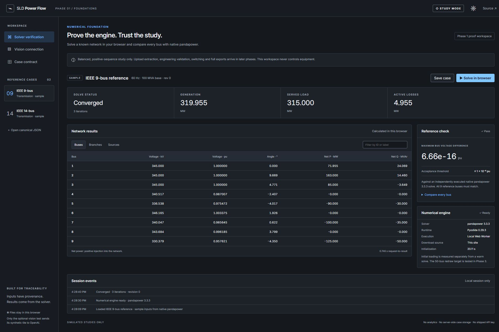

# SLD Power Flow

A browser-local study workspace for turning a reviewed single-line diagram into a traceable AC power-flow case. **Study mode only: this application never controls equipment.**

**Phase 1 foundation:** real pandapower in a Pyodide Web Worker, IEEE 9/14-bus samples, native-reference comparisons, a versioned canonical case, and a visitor-key vision connection proof. The full upload/review/operator workflow is developed in later phases.

Live site: [GitHub Pages](https://divyanshchaudhary85.github.io/sld-power-flow/). Deployment and proof status are recorded in [the Phase 1 report](docs/phase-1.md).



## Try the foundation

1. Open the site and allow the numerical runtime to load in the background. The first load transfers approximately 47 MB of numerical assets.
2. Choose **IEEE 9-bus** or **IEEE 14-bus**, then **Solve in browser**. No API key is needed.
3. Compare every bus against the separately generated native reference. The acceptance threshold is a maximum voltage-magnitude difference of `1e-6 pu`.
4. Inspect the current canonical document under **Case contract**, or save it as JSON. Imported cases require explicit confirmation after inspecting the inputs.
5. For the separate vision proof, open **Vision connection**, enter a model ID available to your account and your own OpenAI key, consent to sending the synthetic tile, and run the test. A schema-valid response demonstrates API connectivity, not measured extraction accuracy.

## Run locally

Use Node **22.17.1** and Python **3.13.5** (the versions used by CI).

```sh
npm ci
python -m venv .venv
# Activate .venv using your shell, then:
python -m pip install -r requirements-lock.txt
npm run provision:runtime
npm run dev
```

The local URL includes `/sld-power-flow/`. The runtime provisioner downloads assets from pinned upstream URLs, verifies SHA-256 digests, and writes the ignored `public/runtime/` directory. Visitors then load those assets from this site's own origin. The provisioner also copies the current Python adapter into the runtime; re-run it after changing that adapter.

```sh
npm run lint
npm run typecheck
npm test
python -m pytest tests/python
npm run test:runtime
npm run build
npm run preview
```

`test:runtime` runs actual Pyodide/pandapower with all network access forbidden. It is distinct from the live-browser acceptance proof. Committed reference fixtures are not regenerated during CI. A deliberate fixture update uses `python scripts/generate_fixtures.py` and requires review of the resulting changes.

## Trust boundaries

- All electrical quantities are computed by the numerical solver or deterministic conversion code. The vision model performs perception only.
- Inputs use `drawing`, `user`, `library` or `default` provenance. Missing values are distinct from accepted defaults and from zero.
- Explicit switches survive in the canonical model; bus reduction occurs inside the adapter. Intentional outages retain unavailable results and unserved-demand information.
- Results carry a model revision and input fingerprint. Changed or unreviewed inputs cannot receive an old solution.
- JSON Schema checks structure. Full engineering rule validation is Phase 2, not implied by a structurally valid import.

See [model contract](docs/model.md), [runtime details](docs/browser-runtime.md), and [CI/deployment](docs/ci.md).

## Privacy and limitations

No analytics, login, application backend, or shipped API key. Case inputs and calculations stay in the visitor's browser. The optional vision proof sends only the displayed synthetic tile and request instructions directly to OpenAI. Its API key is held in memory, is not stored in browser storage, and is cleared when leaving that panel. `store:false` is requested; [OpenAI's data policy](https://developers.openai.com/api/docs/guides/your-data) still applies. Do not enter secrets into a case document or drawing.

This foundation handles balanced positive-sequence, steady-state studies up to 50 reduced electrical buses. It does not implement unbalanced flow, short-circuit, protection coordination, dynamic behavior, contingencies, three-winding transformers, or live SCADA. Phase-shifting tap characteristics and direct busbar service outages are explicitly rejected in this phase. Loads must be represented as constant PQ; motors are loads. Static generators do not form islands automatically.

Extraction accuracy has **not** been measured. Full diagram uploads, tiling, extraction/review, engineering validation, operator actions, durable open-case storage and complete case/solution/report exports remain later-phase features. Real-world drawings are not part of this repository. Keep any future private drawings and cases in the ignored `private/` directory and never commit them.

## Licences

Application code: [MIT](LICENSE). Inter 4.1: [SIL OFL 1.1](public/notices/Inter-LICENSE.txt). Pyodide and numerical wheels retain their own licences; the provisioner extracts their notices. The build writes a complete installed JavaScript package list to `notices/dependencies.json`, and the numerical runtime exposes its manifest and notices. See the pinned lockfiles for exact versions and integrity records.
