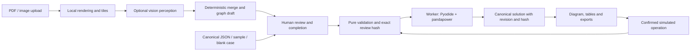

# Architecture and reading guide

This is one static browser application with a Python numerical core. React owns the workspace and views. A Web Worker hosts Pyodide and pandapower, so numerical work does not block the main UI thread. Native Python runs the same conversion code for testing and reference checks. Optional vision requests leave the browser only after consent and use an in-memory user key.

This guide describes implemented code. [Release verification](release-verification.md) records executed acceptance evidence. Live-key vision testing was deferred by the user; real drawing accuracy and actual Siemens PSS/E verification remain outstanding.

The shared contract is `StudyDocument`: every stage reads or updates that envelope. Source drawing bytes live in IndexedDB and are referenced by IDs. The canonical document contains source references, observations, editable equipment, review state, validation findings, operator events and the current solution.

## One input field, from drawing to solve

A known engineering value has `status: "known"`, a typed value, provenance and an optional derivation. Missing data has `status: "missing"`, a reason, candidate readings and evidence. `0`, `false`, an explicitly allowed `null`, and a missing field are distinct.

Drawing provenance retains confidence and locations. User corrections, accepted library types and accepted defaults have different provenance. An offered suggestion is not an input until accepted. `src/completion/missing.ts` knows which attributes the numerical solve actually requires; optional unknown nameplate ratings can remain missing and limit only the applicable rating checks.

For example, a load's `p_mw` is not an ordinary number in the input document. Read its accepted value only after checking its status. In a result table, a number instead uses `status: "available"`; a dead or unsolved load may have unavailable electrical values. The application never replaces an unavailable voltage with zero to make a table look complete.

Read `src/model/types.ts` beside [the model contract](model.md). `schema/study-document.schema.json` validates the external shape. `src/model/validation.ts` also checks finite JSON and cross-references. Draft missing terminals are allowed; a known terminal pointing to a nonexistent point is not.

## Module boundaries

| Module                                                    | Responsibility                                                                    | Important boundary                                                             |
| --------------------------------------------------------- | --------------------------------------------------------------------------------- | ------------------------------------------------------------------------------ |
| `src/main.tsx`, `src/App.tsx`, `src/ui/`                  | Render the workspace and user controls                                            | Display existing fields/results; do not calculate substitute power flows       |
| `src/useWorkspace.ts`                                     | Own case replacement, import, persistence, validation and async solve transaction | Every asynchronous solve boundary checks the current operation generation      |
| `src/model/`                                              | Typed envelope, strict validation, input fingerprint, revision/edit helpers       | Engineering edits invalidate review and results                                |
| `src/ingestion/`                                          | Local decode, PDF text, deskew, region and tile coordinates                       | Original-page evidence remains traceable through transforms                    |
| `src/extraction/`                                         | Provider schema, request budget, merge, connectivity draft and evaluation         | Vision observations never calculate electrical results or silently fill data   |
| `src/completion/`                                         | Required-field list, explicit standard types and default suggestions              | Offers remain separate from accepted input                                     |
| `src/validation/`                                         | Deterministic engineering catalog and topology analysis                           | Findings explain problems; validation does not repair inputs                   |
| `src/operations.ts`                                       | Confirmed switch/service/tap/setpoint actions and base comparison/reset           | A new intentional outage cannot silently authorize an old accidental island    |
| `src/solver/client.ts`, `protocol.ts`, `solver.worker.ts` | Typed Worker requests, cancellation and result matching                           | Revision plus input hash bind a response to the reviewed case                  |
| `src/solver/runtime.mjs`                                  | Integrity-checked Pyodide initialization and Python calls                         | Runtime assets are served from the site's own origin                           |
| `python/solver_adapter.py`                                | Node-breaker conversion, actual AC solve, results and native diagnostics          | Pandapower is the numerical authority                                          |
| `src/exports/`, `python/exporters.py`                     | Tables, documents and numerical exchange files                                    | Native exports are reduced snapshots; canonical JSON preserves original intent |
| `src/storage.ts`                                          | IndexedDB access for current case and drawing blobs                               | Keys are never stored here                                                     |

## A beginner's code trace

Start at `src/main.tsx`: it mounts `App` and the shared stylesheet. `App` composes views and user actions, while `useWorkspace` owns the current document and asynchronous lifecycle. UI components receive that document through props; there is no hidden application server supplying the engineering answers.

Choose a load from `public/fixtures/case9.json`. Its stable element ID follows the input through the UI, validation findings, solver mappings, solution table and exports. Its `p_mw` field carries a value and provenance; its terminal refers to a connectivity-point ID. Follow `listMissingData` to see which inputs are required, then `validateNetwork` to see electrical checks. In Python, follow `to_pandapower` into the native element creation and `solve_document` back to canonical results.

For a UI change, edit `src/ui/` and inspect it with the local dev server. For a model or solver change, first make a focused failing test in `tests/` or `tests/python/`. Edit source files, not `dist/`, `public/runtime/` or `node_modules/`. The runtime directory contains provisioned copies; changing those copies would be lost on the next provisioning run.

## Edits, review and asynchronous safety

Use `commitEngineeringEdit` or a specific editing/completion helper for electrical changes. It clones the document, increments revision, clears validation and review, and marks an existing solution superseded. A view-only choice should not change electrical inputs. `confirmReview` is called only for explicit user confirmation or a trusted bundled reference case.

`computeInputHash` hashes accepted electrical inputs, their provenance, topology, settings and island policy. Layout, event history and result values are excluded. Review records both revision and hash. Matching a revision number alone is insufficient: an imported or accidentally mutated value could otherwise masquerade as reviewed.

`runWorkspaceSolve` is the transaction shared by the hook and its tests. It clears prior current results, validates a snapshot, verifies the exact review, captures the first base if necessary, calls the Worker, attaches only a matching run, and measures the commit/redraw interval. Case replacement, imports, newer solves and validation invalidate older transactions. Old success, error and `finally` callbacks cannot overwrite a newer case or clear its busy indicator.

The browser client and Worker independently check the review hash. `attachSolution` checks revision and hash again at the final model boundary. Cancellation terminates the Worker; it must initialize again before another solve. Ordinary input invalidation discards old responses while allowing the warm runtime to remain.

A canonical import deliberately clears active results, validation, approval and its supplied base snapshot. Historical events remain history. Otherwise an imported base followed by Reset could bypass review. A locally captured base stores equipment/settings in `base_snapshot` and its reviewed island policy in a matching compare event. Reset restores that case, logs the action and stamps the resulting inputs.

Drawing correction has a separate path in `src/model/endpointReview.ts`. It finds the wire's canonical net from retained evidence, requires an explicit choice if ambiguous, then joins it to a selected terminal or net. A false-positive endpoint may be classified as non-electrical with a reason. Both paths retain source observations and record a review decision; neither silently treats a visual crossing as a junction.

`src/ui/ConfirmDialog.tsx` provides the shared confirmation surface for operations, deletion and retyping. Native modal behavior makes background controls inert. Cancel receives initial focus, Tab is bounded to visible controls, Escape cancels, and dismissal restores focus. These interaction guarantees are separate from numerical validation.

## Topology and intentional outages

The editable model preserves each switch and terminal. `analyzeTopology` unions only closed in-service ideal switches, then treats lines/cables/transformers as branches. It returns reduced nodes, component membership, canonical mappings and energized/de-energized IDs for validation and display. The Python adapter performs numerical reduction independently.

Each energized component needs a confirmed grid-forming reference. Static generation and storage do not automatically become island sources. An accidental source-less island blocks preparation. A confirmed operator action may authorize the newly isolated equipment; it remains visible as an outage finding, and the solve reports unserved demand without invented dead-bus values. Opening a device does not authorize some different island that was already disconnected.

See [the complete 24-rule catalog](phase-2.md) for drawing, topology, engineering, completeness and post-solve rules. Native pandapower diagnostics add findings with their own IDs; they are not a replacement for the pure catalog.

## Numerical conventions and exports

The model is balanced positive-sequence steady-state AC with fixed user-selected transformer tap position and T transformer equivalent. It is not an unbalanced feeder, protection, short-circuit or dynamic simulator. Voltages are line-to-line kV; power is MW/Mvar; angles are degrees. Generation is positive injection, load is positive consumption, and each branch-end power is positive from that bus into the branch. Read the explicit conventions stored in every case before converting a format.

`python/solver_adapter.py` maps canonical IDs to native buses/equipment and back, applies accepted settings, runs Newton–Raphson power flow, and returns unavailable values for dead or failed results. The browser supplies the authoritative JavaScript input hash; Python returns it unchanged for matching. Do not substitute a separately serialized Python hash at this boundary.

Canonical JSON is the round-trip source model. Pandapower JSON, MATPOWER and PSS/E RAW exports represent reduced numerical snapshots and may need explicit format placeholders or equivalent shunts/taps. Their warnings explain those changes. Spreadsheet/CSV/PDF output presents inputs, assumptions, findings and results for inspection. [The native export guide](../python/EXPORTS.md) describes round-trip tests and the distinction between an independent RAW parser and verification in actual PSS/E software.

## How evidence is organized

`tests/model.test.ts` checks the schema and revision boundary. `tests/validation.test.ts` includes a clean control and deliberate failure for every catalog rule. `tests/operations.test.ts` uses real canonical fixtures and controlled asynchronous completions to test review, outage authorization, reset and stale-state behavior. Ingestion/extraction tests use deterministic observations, not undocumented live model calls.

`tests/python/` runs actual pandapower, diagnostics and export checks. `tests/runtime.proof.mjs` runs actual Pyodide against separately committed references with network access disabled during execution, and produces native-format exports. `tests/python/verify_runtime_raw.py` independently parses and re-solves its emitted RAW files. `public/fixtures/` contains reviewable cases and reference evidence. These references are not regenerated as part of CI. `test-results/` is generated local/CI evidence, and `docs/evaluation/` labels its synthetic evaluation explicitly.

Automated parser/solver checks and browser interaction are different evidence. Consult the release reports for what was actually executed. A synthetic reconstruction test does not measure real drawing extraction accuracy, and a small reference case does not establish a 50-bus timing result on every device.

## Build and deployment

`package-lock.json`, `requirements-lock.txt` and `runtime-lock.json` pin the JavaScript, native Python and browser numerical environments. The runtime provisioner verifies asset SHA-256 values, copies the current Python adapter/exporter and creates notices. Re-provision after changing either Python module before testing it in a browser.

Vite builds a static `dist/` with base path `/sld-power-flow/`. `scripts/prepare-static.mjs` copies browser-needed schema/PDF assets, verifies both bundled Inter fonts and writes package/font notices. GitHub Actions runs lint, TypeScript, frontend tests, native tests, real runtime/RAW proofs and build before publishing the main-branch artifact to Pages. [CI details](ci.md) explain the permissions and immutable action pins.

For the day-to-day commands and IDE tasks, return to [Start here](../START-HERE.md).

## UI implementation choices

The suggested diagram and styling libraries were optional. This version uses owned SVG components and ordinary CSS so the review canvas, operator diagram, PDF drawing and synthetic fixtures share one symbol implementation and one coordinate model. At the declared 50-bus scope, native HTML tables provide sorting, filtering, keyboard selection and horizontal scrolling without another table state layer. Long assumptions registers are paginated in PDF exports. PDF.js, UTIF, ExcelJS, pdf-lib and JSZip handle their specific file formats; numerical results still come exclusively from the solver worker. These choices keep the approved panel design and make the project easier to read in an IDE.
